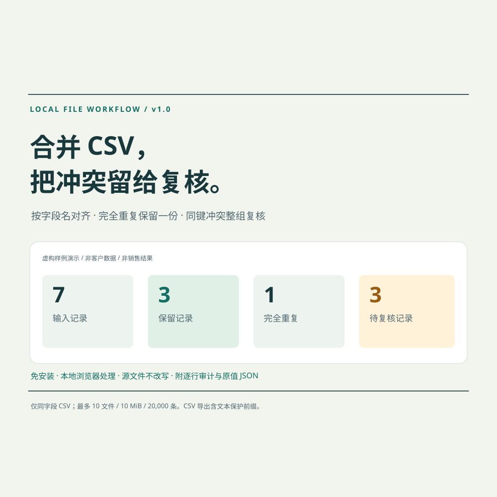

# CSV 本地合并与冲突复核 · 作品展示

这是一个本地数据整理工具的公开作品介绍，展示已经实现的功能、纯虚构输入与实际运行结果。**当前未开放购买，本仓库没有收款或交付入口。**

## 要解决的问题

把同一套字段的多份 CSV 拼在一起时，列顺序可能不同；同一编号可能完全重复，也可能对应不同版本。简单按编号删除重复容易覆盖不同内容。

本工具采取保守规则：按字段名对齐；整行完全相同只保留第一份；所选业务键相同、任意内容不同则整组进入人工复核，不自动挑一个版本覆盖。

## 实际做出的功能

完整工具已实现为本地单 HTML 文件，无外部脚本、联网请求或 API：

- 读取字段名称集合相同、列序可不同的 CSV；支持明确选择 UTF-8、浏览器支持的 GB18030/GBK 或 UTF-16LE，以及逗号、Tab 或分号。
- 按整行去重，或选择业务键识别冲突；缺失键和空行单独复核。
- 为每条输入保存来源、记录序号、起始物理行、处理状态和原因，核对输入 = 保留 + 完全重复 + 待复核。
- 导出保护版合并 CSV、逐行审计 CSV、原值 JSON 与运行摘要；源文件不改写。
- 限制为最多 10 文件、总 10 MiB、20,000 条数据、100 列；不支持 XLSX、不同字段映射、模糊匹配、财务计算、CRM 接入或定时自动化。

CSV 导出为人工表格查看对可能的公式文本及部分数字标识符添加可见的 `[TEXT] ` 前缀。这会改变内容，负数也可能变成文本；需要原值时使用 JSON。保护版 CSV 不适合不经复核就导回业务系统，也不保证所有表格软件的类型推断行为。

**本公开仓库只提供说明、固定演示与静态样例结果。完整软件、任意文件处理实现和付费下载包没有公开在这里。**

## 固定样例：7 = 3 + 1 + 3

输入中的物品、编号、地区与备注全部虚构，不含真实客户或个人信息，不代表订单、客户案例或收入。

| 文件 | 内容 | 用来展示什么 |
|---|---|---|
| [source-a.csv](samples/source-a.csv) | 4 条虚构记录 | 引号内逗号、多行字段、同键旧版本 |
| [source-b.csv](samples/source-b.csv) | 3 条虚构记录，列序不同 | 完全重复、同键新版本、缺失编号 |

以 `record_id` 为业务键，已有完整工具核心实际运行得到：

| 去向 | 条数 | 解释 |
|---|---:|---|
| 保留 | 3 | DEMO-001、DEMO-002 第一份、DEMO-003 |
| 完全重复 | 1 | DEMO-002 第二份，原文完全一致 |
| 待复核 | 3 | DEMO-004 两个不同版本整组复核；另 1 条缺编号 |
| 输入合计 | 7 | 3 + 1 + 3，无静默丢行 |

可以直接查看以下静态产物：

- [合并结果 CSV](outputs/merged-example.csv)：只含 3 条保留记录。
- [逐行审计 CSV](outputs/row-audit-example.csv)：7 条记录全部有去向，包含原始字段 JSON。
- [原值与状态 JSON](outputs/original-example.json)：输入原文、来源与状态。
- [运行摘要 JSON](outputs/summary-example.json)：规则、数量与核对。

[固定样例演示 demo.html](demo.html) 可下载后双击查看。它只切换固定样例表格，不读用户文件、不包含通用 CSV 解析器，也不承担完整工具功能。此仓库尚未声明配置 GitHub Pages；仓库文件链接不等于在线演示网站。

## 制作方式与验证边界

本项目使用 AI 辅助进行需求梳理、代码、文案、原创 SVG 和测试编写。未使用他人品牌标识、抓取素材、虚构从业资历或客户背书；作品公开不代表平台已认证。

完整工具内部已运行 17 项核心检查与 4 项模拟 DOM 状态检查，覆盖引号、换行、BOM、列序对齐、去重/冲突、审计条数、导出文本保护、数据清空与状态失效。它们没有全部发布在此仓库，不能将此仓库的静态检查等同于完整软件验收。

**实际浏览器布局、原生文件导入/下载及交易交付尚未完成端到端验证。** 本仓库的固定样例与说明不能替代这些检查。数据整理仍须保留源文件并人工复核。

公开材料的基本检查记录见 [CHECKS.md](CHECKS.md)。

## 项目状态与联系

- 当前阶段：作品展示、格式适配与小规模需求验证；没有销售数量、客户评价或收益证明。
- 当前购买状态：未开放购买。预先研究过的测试价格不是这里的付款邀请。
- 官方创作者主页：[爱发电 · 本项目](https://afdian.com/a/bin53)；[已发布的功能样例说明](https://afdian.com/p/82ecc6e4cdf611f19a9d5254001e7c00)。这是同一项目的公开创作与需求验证入口，创作者认证仍待平台审核，不是当前软件的付款入口。
- 正式商品页：**尚未开放；完成资格、交付与收款核验后再补充**。
- 可使用仓库 Issues 讨论一般格式与功能问题；不要上传真实个人资料、商业机密或未脱敏原文件。项目目前没有全天候响应或持续运行承诺。

Excel Power Query、脚本及免费 CSV 工具能处理相似任务。本作品展示的是一个免安装、可复核的具体实现；尚无本产品付费意愿验证或收益保证。

## 使用与授权

本仓库公开展示材料可用于查看和内部评估，具体范围见 [LICENSE.txt](LICENSE.txt)。它不是完整软件的开源许可，也不授权转售私有工具。用户自己的输入和输出数据权利不归本项目主张。
